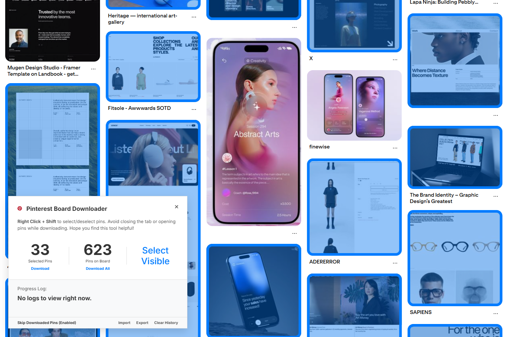
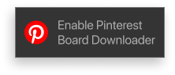

# Pinterest Board & Pin Downloader Extension

## Features

This extension simplifies downloading images from Pinterest with powerful, user-friendly features:

*   **Download Entire Boards**: Easily download all pins from any Pinterest board you're viewing.
*   **Individual Pin Selection**: Hover over any pin to select it and add it to your download queue.
*   **Select All Visible Pins**: Quickly grab all pins currently displayed on your screen.
*   **Best Image Quality**: Get the highest resolution images available for crisp, clear downloads.
*   **Skip Already Downloaded Pins**: Avoid duplicates by automatically skipping pins you've already downloaded (enabled by default).
*   **Download in Batches**: Experience smoother performance with downloads processed in smaller batches.
*   **History Management**:
    *   **Import & Export History**: Easily back up and transfer your download history using a JSON file.
    *   **Clear History**: Start fresh by clearing your entire download history with a single click.
*   **Minimized View**: A more compact interface option.
*   **Improved Memory Management**: Prevents slowdowns during long downloads by clearing old pins.
*   **Image Downloads Only**: Focuses solely on downloading images for a fast and efficient solution.
*   **Endless Mode**: Endless Mode makes the Pinterest Board Downloader fully automatic: it endlessly scrolls, loads, selects, and downloads pins in batches forever—no manual clicks needed. Ideal for massive or growing boards. Stop anytime with one click.
*   **Marquee Over Pins To Select Items**

## How to Install (Chrome & Edge)

Get started in just a few steps:

1.  **Download the latest release**: Grab the `.zip` file from the [releases page](https://github.com/rrokutaro/pinterest-board-downloader/releases).
2.  **Extract the file**: Unzip the downloaded file to a convenient location on your computer (will be named "browser-extension" after extracting).
3.  **Open Extensions**:
    *   **Chrome**: Go to `chrome://extensions/`
    *   **Microsoft Edge**: Go to `edge://extensions`
4.  **Enable Developer Mode**: Toggle on **Developer mode** in the top right corner.
5.  **Load Unpacked**: Click on **Load unpacked** and select the folder you extracted in step 2.
6.  **Start Downloading**: Navigate to Pinterest and begin downloading your favorite pins!

## How to Install (Firefox)

A dedicated Firefox build lives in the [`firefox-extension`](./firefox-extension) folder. It has the exact same features as the Chrome build — only the `manifest.json` and the way GSAP is loaded were adapted for Firefox.

> ### ⚠️ Read this first — don't use `about:addons`
> If you go to `about:addons` → ⚙️ → **Install Add-on From File** and pick the extension, Firefox will say it **"appears to be corrupt / damaged"**. The file is **not** corrupt — that message is Firefox's (confusingly worded) way of saying *"this add-on isn't signed by Mozilla."* Regular Firefox refuses to **permanently** install any unsigned add-on. Use the **`about:debugging`** method below instead, which is made for loading unsigned add-ons.

### How to load it — use `about:debugging`

This works on any Firefox, needs no signing, and is the only method you need. **Do not use `about:addons`** (see the warning above).

1.  Type **`about:debugging`** in the address bar and press Enter.
2.  Click **This Firefox** in the left sidebar.
3.  Click **Load Temporary Add-on…**.
4.  Open the **`firefox-extension`** folder and select **`manifest.json`**.
    *   ⚠️ Keep the whole folder together — `manifest.json` must sit next to `client.js`, `gsap.min.js`, `gsap-shim.js` and the icons. Don't copy `manifest.json` out on its own.
5.  Go to [pinterest.com](https://www.pinterest.com/), open a board, and the **"Enable Pinterest Board Downloader"** bar appears at the bottom.

**If the bar doesn't show up:** when loaded this way, Firefox may not auto-grant site access. Open `about:addons` → the extension → **Permissions** tab → enable access for **`pinterest.com`**, then reload the Pinterest tab.

> **Note:** a temporary add-on is removed every time you **restart Firefox** — just repeat the steps above (10 seconds) to load it again. After editing any file, click **Reload** on the add-on in `about:debugging`.

See [`firefox-extension/README.md`](./firefox-extension/README.md) for troubleshooting and the exact differences from the Chrome build.

### Why `about:addons` failed but `about:debugging` works

| | `about:addons` (Install From File) | `about:debugging` (Load Temporary) |
|---|---|---|
| Requires a Mozilla signature? | **Yes** — mandatory on normal Firefox | **No** |
| Permanent? | Yes, stays installed | No, cleared on restart |
| Unsigned result | "appears to be corrupt" error | ✅ loads fine |

Firefox has required add-ons to be signed since Firefox 48 (2016) as an anti-malware measure, and on the Release channel that requirement can't be turned off. `about:debugging` exists specifically so developers can load unsigned add-ons for testing — the trade-off being that they're temporary.

## How to Use the Extension

### Download All Board Pins

To download every pin on a Pinterest board, simply click the second download button (the one in the middle) in the extension interface.

 

### Download Specific Pins

Want to pick and choose? Here's how:

*   **Select/Deselect Pins**: Hold down the `ShiftKey` + `rightClick` on any pin to select it. Right-clicking again (while holding shift) will deselect it.
*   **Download Selected**: Once you've selected your pins, click the first download button.
*   **Select All Visible**: Use the "Select All Visible Pins" button to bulk select currently visible pins.

### Marquee Over Pins To Select
`Shift + Right Clck` to marquee/select multiple items (`Shift + Alt + Right Clck` to unselect).

